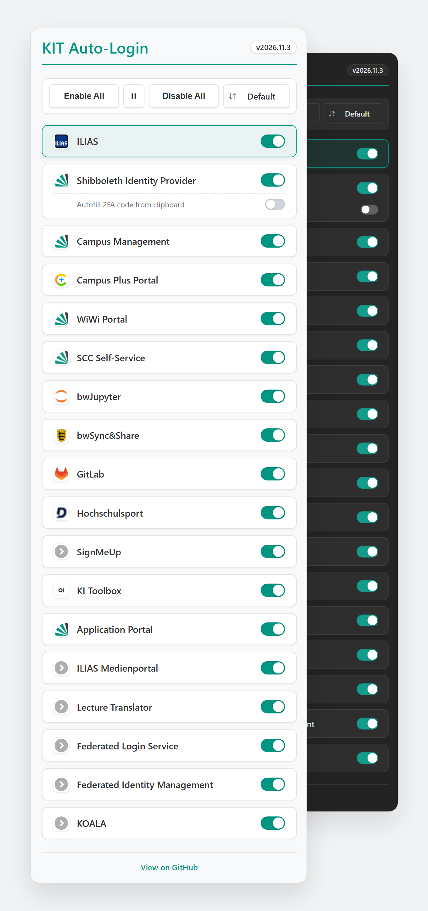

  </img>

<h1 align="center">KIT Auto-Login</h1>

- **Automatic Login:** Zero-click login for various KIT services
- Works seamlessly with your existing password manager
- Enable or disable the extension for each supported site individually

## Installation

 

Safari (iOS & macOS) Instructions

Safari on iOS and macOS is supported through a userscript version of this add-on. It supports both Passkeys and password managers.

1. Make sure you have either a passkey registered for your account at the [SCC Self-Service Portal](https://my.scc.kit.edu/) or your KIT credentials saved in your password manager.
2. Install the [Userscripts](https://apps.apple.com/de/app/userscripts/id1463298887) app from the App Store.
3. Activate the Userscripts Safari extension in the Settings app.
   * **iOS 26:** `Settings` → `Safari` → `Extensions` → `Userscripts` → `Allow Extension`
4. Open the [**Install Userscript (`kit_auto_login.user.js`)**](https://raw.githubusercontent.com/nicolasjweber/KIT-Auto-Login/main/kit_auto_login.user.js) link in Safari and tap the Userscripts extension icon in the address bar to install it with one tap (or save `kit_auto_login.user.js` into `Files` → `On My iPhone` → `Userscripts`).
5. For each site where you want to use auto-login, allow Userscripts to run by pressing the extension button in Safari (on the left of the current URL) and granting access.
   * **Action:** `Userscripts` → `Always Allow`

## Prerequisites

This extension automates the clicking of login buttons, but it **does not store your passwords, passkeys, or cookies**. 

- **Firefox & Chromium:** For fully automatic login, ensure your password manager (or browser) is configured to autofill your KIT username and password.
- **Safari:** The Safari userscript supports both Passkeys and password autofill. Once your passkey is confirmed or your password manager fills in your credentials, login proceeds automatically.
- If the extension isn't working, verify in your browser extension settings that it has been granted permission to read and change data on the supported KIT websites.

## Screenshot & Supported Sites

  <picture>
    <source media="(prefers-color-scheme: dark)" srcset="assets/screenshot_readme_dark.png" />
    
  </picture>

Tip: Click on any site in the list to quickly jump to the respective KIT portal.

## Contributing

Contributions are welcome! Please feel free to open a pull request or open an issue to report a bug.

## Disclaimer

This extension is an independent, open-source project and is **not** affiliated with, endorsed by, or officially connected to the Karlsruhe Institute of Technology (KIT) in any way.

## Credits

- Original idea and extension by [philippweinmann](https://github.com/philippweinmann/iliasLogin)
- ILIAS v7.x fix by [BenedictLoe](https://github.com/BenedictLoe/iliasLogin_7)
